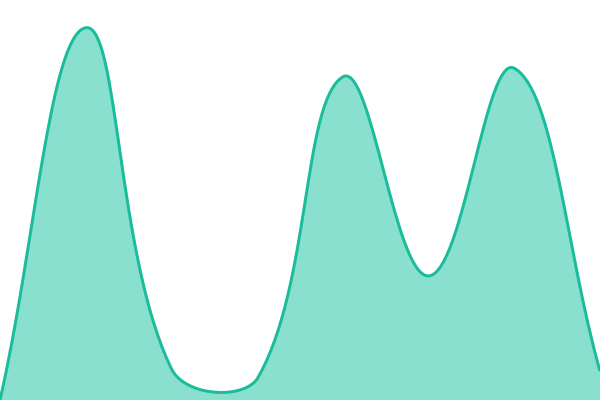

# [📈 État en direct](https://status.place-de-la-mairie.fr): <!--live status--> **Tous les services fonctionnent**

This repository contains the open-source uptime monitor and status page for [dharmachose](https://status.place-de-la-mairie.fr), powered by [Upptime](https://github.com/upptime/upptime).

With [Upptime](https://upptime.js.org), you can get your own unlimited and free uptime monitor and status page, powered entirely by a GitHub repository. We use [Issues](https://github.com/dharmachose/statut/issues) as incident reports, [Actions](https://github.com/dharmachose/statut/actions) as uptime monitors, and [Pages](https://status.place-de-la-mairie.fr) for the status page.

## [📈 Live Status](https://demo.upptime.js.org): <!--live status--> **Tous les services fonctionnent**

<!--start: status pages-->
<!-- This summary is generated by Upptime (https://github.com/upptime/upptime) -->
<!-- Do not edit this manually, your changes will be overwritten -->
<!-- prettier-ignore -->
| URL | Status | History | Response Time | Uptime |
| --- | ------ | ------- | ------------- | ------ |
|  [Service (serveur et base de données)](https://saint-jean-de-chevelu.place-de-la-mairie.fr/api/sante) | Fonctionne | [service-serveur-et-base-de-donnees.yml](https://github.com/dharmachose/statut/commits/HEAD/history/service-serveur-et-base-de-donnees.yml) | 

 5792ms
     
 | 

<a href="https://status.place-de-la-mairie.fr/history/service-serveur-et-base-de-donnees">100.00%</a>
    

|  [Saint-Jean-de-Chevelu](https://saint-jean-de-chevelu.place-de-la-mairie.fr) | Fonctionne | [saint-jean-de-chevelu.yml](https://github.com/dharmachose/statut/commits/HEAD/history/saint-jean-de-chevelu.yml) | 

 1752ms
     
 | 

<a href="https://status.place-de-la-mairie.fr/history/saint-jean-de-chevelu">100.00%</a>
    

<!--end: status pages-->

[**Visit our status website →**](https://status.place-de-la-mairie.fr)

## 📄 License

- Powered by: [Upptime](https://github.com/upptime/upptime)
- Code: [MIT](./LICENSE) © [Anand Chowdhary](https://anandchowdhary.com)
- Data in the `./history` directory: [Open Database License](https://opendatacommons.org/licenses/odbl/1-0/)
